# Gallery
One frame from every style and variant, taken mid-shot with the minimal sample params from `src/samples.js` (so text and numbers are placeholders). Regenerate with `node tools/qa-all.js --gallery docs/gallery` (needs a browser; see the README).

## `ascii`
- **plasma**  
  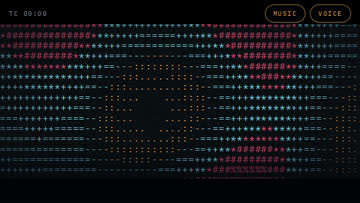
- **rain**  
  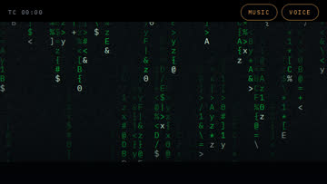
- **text**  
  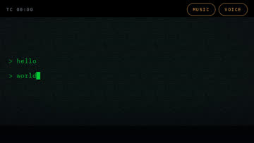

## `atom`
- **molecule**  
  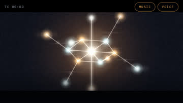
- **prompt**  
  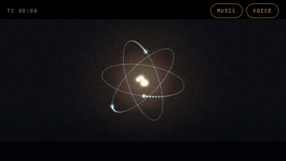
- **spark**  
  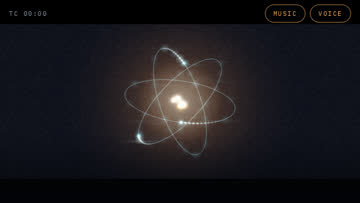
- **universe**  
  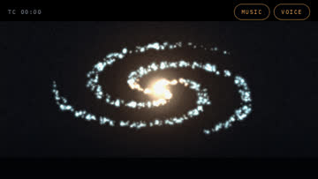
- **wait**  
  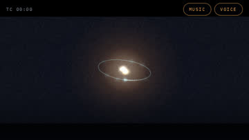

## `board`
- **equation**  
  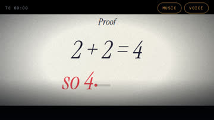
- **icons**  
  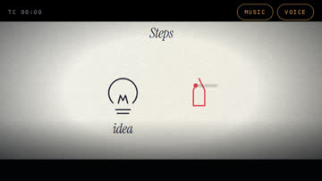

## `cartoon`
- **follow**  
  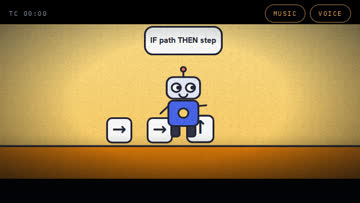
- **heart**  
  
- **wonder**  
  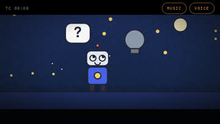

## `chart`
- **learn**  
  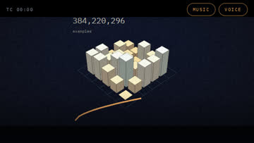
- **skyline**  
  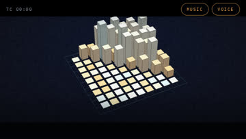
- **skyline2**  
  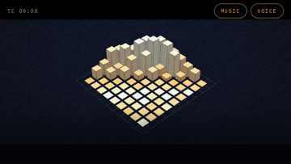

## `clay`
- **shapes**  
  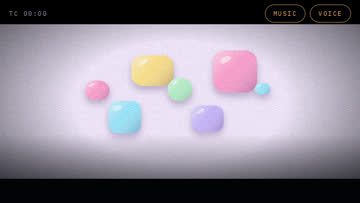
- **text**  
  

## `comic`
- **burst**  
  
- **panels**  
  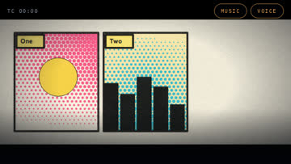
- **speed**  
  

## `domino`
- **cascade**  
  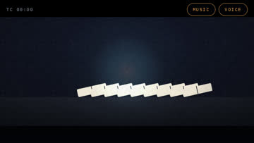
- **title**  
  
- **topple**  
  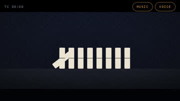
- **wave**  
  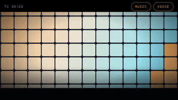

## `explainer`
- **cube**  
  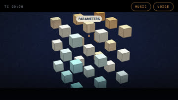
- **neural**  
  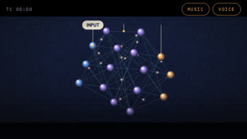

## `gen`
- **blobs**  
  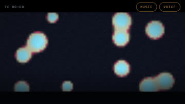
- **flow**  
  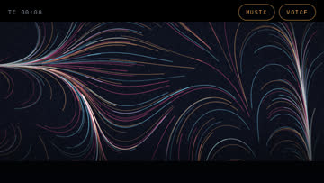
- **mandala**  
  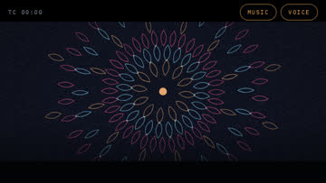
- **voronoi**  
  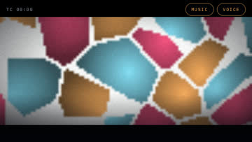

## `glitch`
- **corrupt**  
  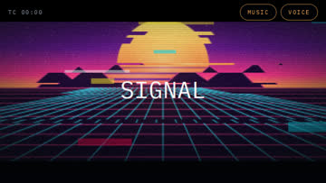
- **rgb**  
  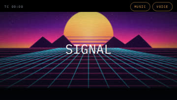
- **vhs**  
  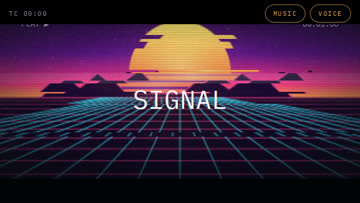

## `image`
- **cutout**  
  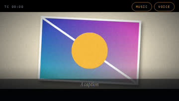
- **kenburns**  
  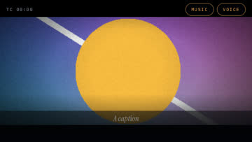
- **logo**  
  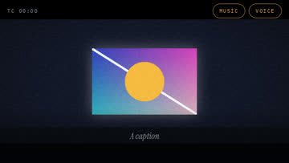
- **polaroid**  
  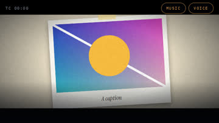
- **pop**  
  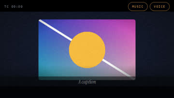

## `ink`
- **bamboo**  
  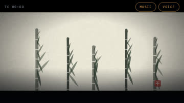
- **calligraphy**  
  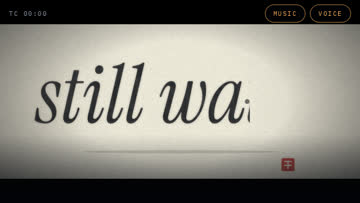
- **mountains**  
  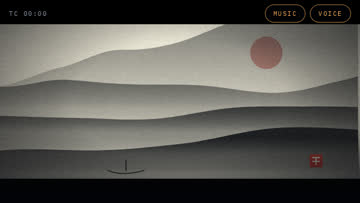

## `iso`
- **city**  
  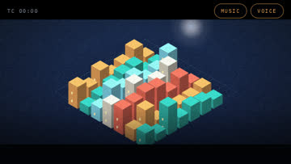
- **city2**  
  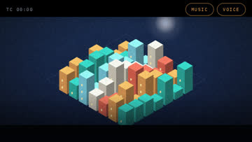
- **cubes**  
  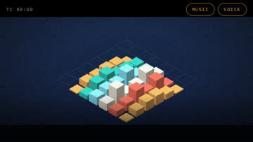

## `lowpoly`
- **orb**  
  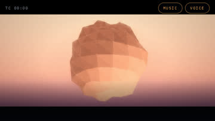
- **terrain**  
  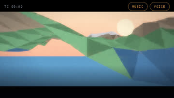

## `map`
- **route**  
  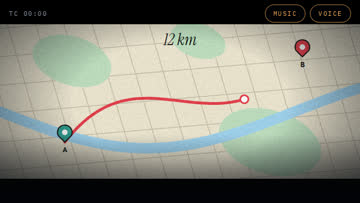
- **timeline**  
  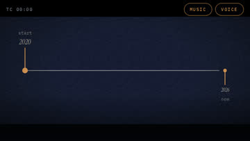

## `math`
- **descent**  
  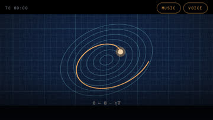
- **prompt**  
  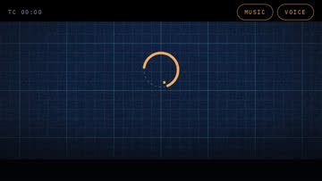
- **sine**  
  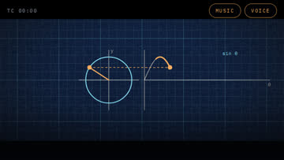

## `memphis`
- **pattern**  
  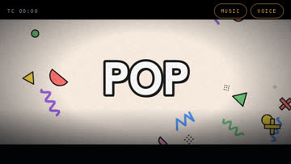

## `multiplane`
- **forest**  
  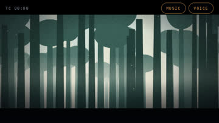

## `origami`
- **boat**  
  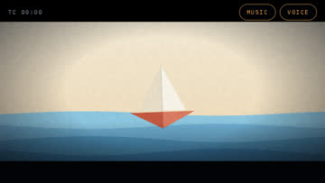
- **fold**  
  

## `paper`
- **land1**  
  
- **land2**  
  
- **window**  
  

## `pixel`
- **city**  
  
- **hero**  
  
- **text**  
  

## `poster`
- **bauhaus**  
  
- **swiss**  
  

## `shadow`
- **gunungan**  
  
- **scene**  
  

## `stage`
- **scene**  
  

## `stopmo`
- **boil**  
  

## `synth`
- **eq**  
  
- **sun**  
  

## `type`
- **focus**  
  
- **stack**  
  
- **wave**  
  
- **words**  
  

## `vapor`
- **grid**  
  
- **windows**  
  

## `voxel`
- **island**  
  
